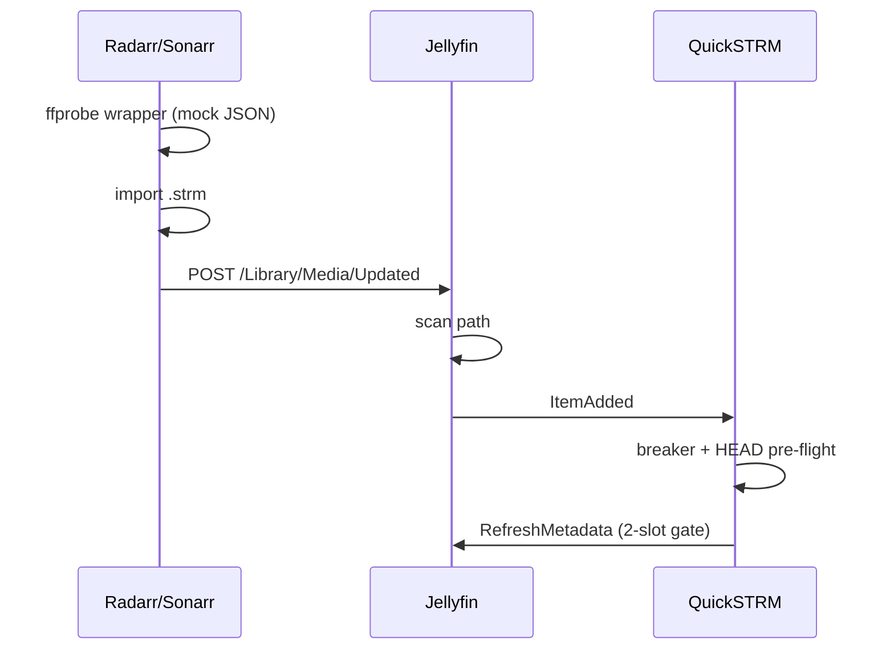

# *arr -> Jellyfin -> QuickSTRM automation

## 1. Native connection (Radarr and Sonarr)

Settings -> Connect -> **+** -> **Emby / Jellyfin** (listed as "Emby / Jellyfin" in current builds)

| Field | Value |
|---|---|
| Name | `Jellyfin` |
| On Import (shown as "On File Import" / "On Import") | ON |
| On Upgrade (shown as "On File Upgrade" / "On Upgrade") | ON |
| On Rename | ON (optional) |
| On Delete triggers | ON (optional; keeps Jellyfin clean) |
| Host | `jellyfin` (or your Jellyfin host/IP) |
| Port | `8096` |
| Use SSL | OFF unless Jellyfin is behind TLS |
| API Key | Jellyfin Dashboard -> API Keys -> **+** -> paste the key |
| Send Notifications | ON |
| **Update Library** | ON (a checkbox, not a trigger; it makes the *arr call Jellyfin's `/Library/Media/Updated`) |

Click **Test**, then **Save**.

## 2. Raw fallback: Custom Script

Use this only if the native connection misses `.strm` imports. Script: [jellyfin-notify.sh](jellyfin-notify.sh).

Mount it into each *arr container (read-only) and set the env vars:

```yaml
    volumes:
      - ./scripts/jellyfin-notify.sh:/scripts/jellyfin-notify.sh:ro
    environment:
      - JELLYFIN_URL=http://jellyfin:8096
      - JELLYFIN_KEY=<api key>
      - PATH_FROM=/data/media   # *arr path prefix
      - PATH_TO=/media          # same folder as Jellyfin sees it
```

Host: `chmod +x scripts/jellyfin-notify.sh`

Settings -> Connect -> **+** -> **Custom Script**:

| Field | Value |
|---|---|
| Name | `Jellyfin .strm notify` |
| On Import / On Upgrade (Radarr: "On File Import", "On File Upgrade") | ON |
| Path | `/scripts/jellyfin-notify.sh` |

The script reads `radarr_moviefile_path` / `radarr_movie_path` (Radarr) or `sonarr_episodefile_path` / `sonarr_series_path` (Sonarr), translates the path, and sends:

```http
POST /Library/Media/Updated
X-Emby-Token: <key>
{"Updates":[{"Path":"/media/Movies/Title (2024)","UpdateType":"Created"}]}
```

If that fails it falls back to `POST /Library/Refresh` (full library scan).

> I'm not aware of a Jellyfin endpoint named `/Library/VirtualFolders/Paths/Refresh`; the path-targeted call is `/Library/Media/Updated`, so the script uses that.

## 3. Event chain

1. Radarr/Sonarr runs `ffprobe` on the `.strm` -> the wrapper returns mock H.264/AAC JSON instantly (no download).
2. *arr imports/moves the `.strm` into the library folder.
3. *arr fires the Jellyfin connection (or the custom script).
4. Jellyfin scans only that path.
5. Jellyfin adds the item and raises `ILibraryManager.ItemAdded`.
6. QuickSTRM's `OnItemAdded` handler runs if **Auto-probe new .strm items** is enabled, the item is a `.strm` and it has no runtime.
7. It calls `ProbeItemAsync`: circuit breaker check -> 500ms HEAD pre-flight -> the shared 2-slot gate -> Jellyfin's own ffprobe via `RefreshMetadata`. The result is stored in the database.



Notes:
- The wrapper only affects the *arr. Jellyfin still probes the real stream itself in step 7, which is why the HEAD pre-flight and the 2-slot limit matter.
- Step 7 goes straight through `ProbeItemAsync`; it is not the `EnqueueBackgroundPersist` queue, which only handles items first played without stream info.
- `EnableAutoProbe` must be ticked in the QuickSTRM dashboard, or step 6 does nothing.
